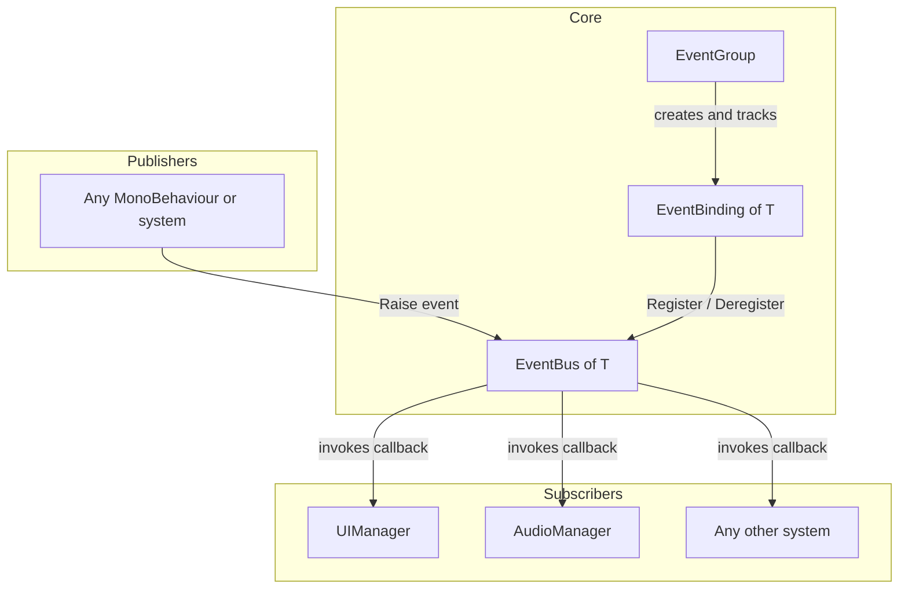
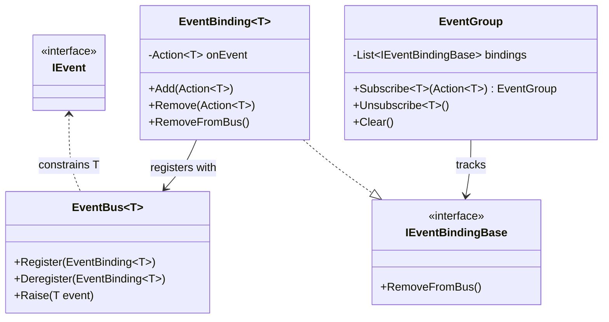
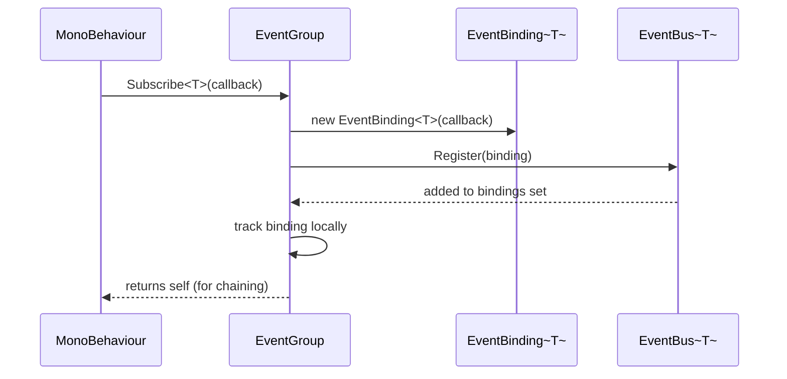
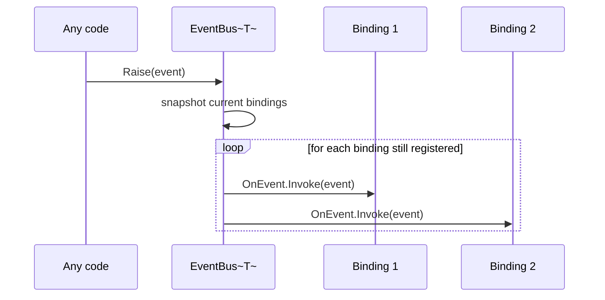
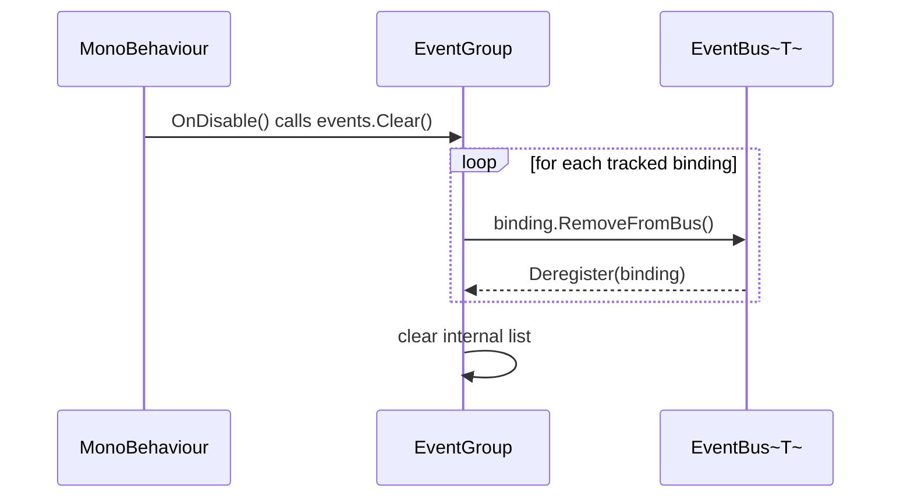
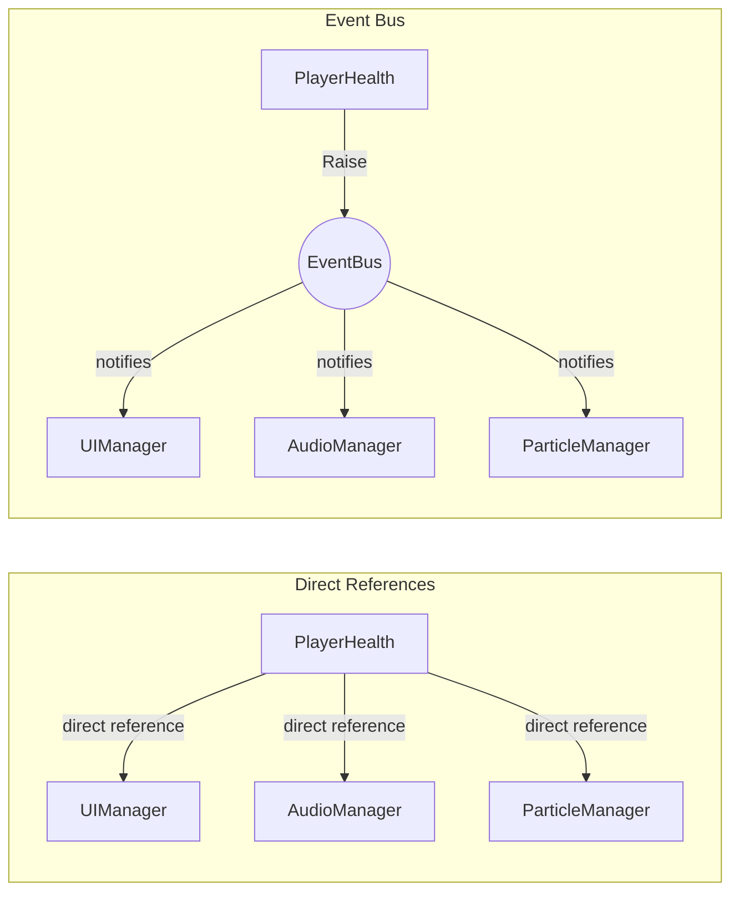

# EventBus Diagrams

## 1. Architecture Overview

## 2. Class Diagram

## 3. Subscription Flow

## 4. Raise Flow

## 5. Cleanup Flow

## 6. Observer Pattern vs Event Bus

Direct references couple the publisher to every subscriber, and adding a new subscriber means
editing the publisher. With an event bus, the publisher only knows about the event it raises —
subscribers can be added or removed without ever touching it.

**When to use events:** occasional, meaningful occurrences (death, level complete, settings
changed). **When to prefer a direct reference:** high-frequency data (position, velocity) updated
every frame, where the overhead and indirection of an event aren't worth it.
